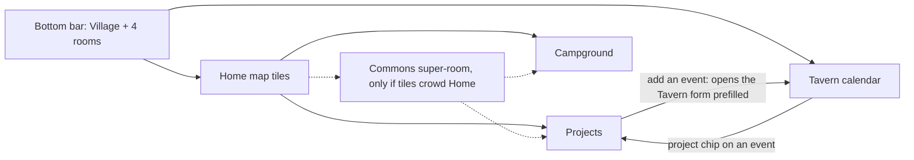

# Two more rooms: Projects and Campground

Written 2026-09-05 as a design; **built the same day** with two changes the
owner made: tasks are only ever *taken* (no assignment by anyone, not even
v1), and the campground stores **no amounts** — a collection and a note, with
its own notification kind. Migrations landed as `009_projects_camp.sql`. The
sections below are the argument; `CLAUDE.md` holds the invariants that
survived.

## Answer first

- Put **Projects** and **Campground** on the Home map as tiles with `nav: false`, the way Houses lives today. The bottom bar stays five.
- The **Tavern calendar is the daily door to Projects**: a project event shows a project chip, and the chip opens the project. The tile is the second door.
- Campground is a rare action (a few times a month, `TBD`), so two taps from anywhere is enough.
- Projects gets one new push kind, `projects`; Campground got one too, `camp` (owner's change). Quiet hours apply to both.
- ~~Campground records amounts.~~ **Built without amounts** (owner's change): a collection and a note, held or handed over. The ledger is the cash box.

## Navigation options

The bar gives each item about 60 px. Home already renders every `ROOMS` entry, `nav: false` included (`App.tsx` `Home`).

| Option | What the villager sees | Taps to a room | What breaks | Verdict |
| --- | --- | --- | --- | --- |
| A. Off the bar, tiles on Home (like Houses) | Bar unchanged. Two more buildings on the map, with badges. | 2 from anywhere (Village, tile). 1 from a calendar chip. | Nothing in code. Tiles grow to 7, so Home scrolls one more row on a phone. | **Recommend.** The pattern exists and CLAUDE.md sanctions it. |
| B. Nest: Projects under Tavern, Campground under Watchtower | Tavern gets a fourth stacked part. Watchtower gets a "visitors" part. | 1 + scroll | Tavern is already three parts. Money in the burglary-info room mixes two purposes. | No. Watchtower stays about empty houses only. |
| C. A "More" building in the bar | A sixth bar item that opens a list. | 2 | Six items at ~50 px each, labels truncate. Breaks the "fits five" invariant. A generic door in a village metaphor. | No. |
| D. Two tile rows on Home, bar shows the 4 most used | Bar differs per house and over time. | 1 or 2 | Muscle memory dies. "Most used" needs a usage counter per house, which the repo does not want to hold. | No. |
| E. Contextual bar (bar changes per room) | In Tavern the bar shows Projects, elsewhere not. | 1 inside the context, unreachable outside | The bar stops being a map of the app. Hard to explain to a house that opens it twice a week. | No. |
| F. "Commons" super-room: Projects + Campground + future Archive | One tile that opens a second menu. | 3 (Village, Commons, room) | One tap more than A for no gain today. It earns a place only when tiles pass ~8. | Later, if tiles crowd Home. Dashed in the diagram. |
| G. Long-press on a tile or bar item | Hidden menu. | 1 gesture | Undiscoverable. iOS long-press fights text selection and the context menu. | No. |

## Projects

A project is a long job. Tasks are its parts, each with a due date and one house that holds it. Events are its dates and live in the existing `events` table.

### Data model (built as `009_projects_camp.sql`, append-only)

| Table | Fields | Notes |
| --- | --- | --- |
| `projects` | `id`, `house_id` (creator), `title`, `notes`, `due_at` (nullable), `state` planned/open/done, `done_at`, `created_at` | A house edits its own rows, a steward any row (`canEdit`). `open` is "in progress"; the value predates the planned state (added 2026-09-09) and stays so no row moves. |
| `project_tasks` | `id`, `project_id` (cascade), `house_id` (creator), `title`, `notes`, `assigned_to` → `houses` (SET NULL), `due_at`, `state` open/done, `done_at`, `closing_note`, `created_at` | One house per task. Several houses on one task: make an event and use sign-ups. |
| `events` + `project_id` → `projects` (SET NULL) | `ALTER TABLE events ADD COLUMN project_id` | Same shape as `needs.run_id`. |
| `events` + `task_id` → `project_tasks` (SET NULL) | `ALTER TABLE events ADD COLUMN task_id` | The backend fills `project_id` from the task. `task_id` without a project is rejected. |

Deleting a project deletes its tasks. Its events stay in the calendar with the link cleared. Nothing else deletes anything: a done task and a past event stay as notes.
`GET /api/export` must include the two new tables in the same change, or the exit stops being complete.

### Permissions

| Action | Who | Why |
| --- | --- | --- |
| Create a project, add a task, add an event | Any house | Same as events today. |
| Assign a task to a house | The house itself ("I take it"), the project creator, a steward | Self-take mirrors Market `taken_by`. Assigning a neighbour without asking is a social risk, see the question below. |
| Close a task | The assigned house, the creator, a steward | The house that did the work says so. |
| Start a project, put it back to planned, mark it done, or reopen it | The creator, a steward | A project begins planned. Open tasks are not blocked by finishing. They stay listed under the done project as "left open". |
| Delete | `canEdit`, with the confirm dialog every room uses | |

> QUESTION FOR THE OWNER: may a house assign a task to another house in the app, or only offer it? Recommendation: **offer only in v0** — a task without `assigned_to` shows "I take it". The creator assigns only in v1, after the houses say they want it.

### UX sketch

**Projects list (`#/projects`)**
- Header, then "+ New project" opening an inline form: title, due date, notes.
- Projects in progress as cards: crest, title, due date, "3 of 5 tasks done", next event date.
- Below, a "Planned" section with the same cards, dashed edge; then a collapsed section "Finished" with done projects, faded like a done need.
- Home badge: projects in progress and their free tasks. A planned project counts nowhere — a plan is not work waiting for hands (owner's decision 2026-09-09).
- No per-house count anywhere. "3 of 5" is a project's progress, not a house's.

**Project page (`#/projects/:id`)**
- Header: title, due date, state, creator crest. For `canEdit`: "Start" on a planned project; "Back to planned" and "Mark finished" on one in progress; "Reopen" on a finished one.
- Tasks: open first, each a card with due date, holder name or "I take it", "Done" button. Done tasks below, faded, showing `closing_note`.
- "+ Add a task" inline form: title, due date, notes.
- Events: "Ahead" then "Happened", cards reused from `Calendar.tsx` with sign-ups.
- "+ Add an event" is a link to `#/tavern?project=ID` — one event form in the app, not two.
- Closing a task asks for one optional line, stored as `closing_note`.

**Tavern calendar**
- The event form gets a "Project" select, like the run select in Market — every project not finished, planned ones included. Picking a project shows a "Task" select of that project's open tasks.
- `?project=ID` opens the form with the project preselected.
- The event card shows a chip "📋 project title" that links to the project page.
- The month grid does not change.

### Push

| Moment | Kind | Who hears | Quiet hours |
| --- | --- | --- | --- |
| New project | `projects` | All houses but the author | Waits |
| Task assigned to a house | `projects` | That house only (`notifyHouse`) | Waits |
| New event on a project | `events` (existing) | All houses but the author | Waits |
| Due reminder | — | — | Not in v0. If added, read off `due_at` and one `reminded_at`, like tools. No counter. |

`Kinds` grows to nine (`projects`, `camp`). The `notify_off` comment, the "all seven kinds" line in CLAUDE.md, the Houses prefs screen and `banner_test.go` change in the same commit.
Lock-screen line: a task push names a house and a date. It says nothing about an empty house, so it sits on the "named" side of the rule. Free-text titles can leak anything, same as events today.

### "Completed stays visible"

Done is a state, not a deletion. The list shows open projects on top and done ones in a collapsed "Finished" section. A done project page reads the same as an open one, with tasks and events as notes. Reopen is one button for `canEdit`. The system never archives or purges on its own.

### v0 cuts

1. No due reminders. Push only on create and on assign.
2. One `assigned_to` per task. No multi-house tasks, no assignment by others (offer only).
3. No second event form. The project page links to the Tavern form prefilled.

## Campground

The village has a parking spot listed on park4night. A house collects money from a camper. The room records one collection per row.

### Data model (built in `009_projects_camp.sql`)

| Table | Fields | Notes |
| --- | --- | --- |
| `camp_takings` | `id`, `house_id` (who collected), `collected_by` (optional first name, like `posts.author`), `from_who` free text, `taken_on` date, `notes`, `state` held/handed, `handed_at`, `created_at` | **No amount** — owner's change. One row is one fact. |

No plate column, no phone, no photo, no nights count. `from_who` is a label a villager would say aloud: "grey camper", "family from NL".

### UX in one card (`#/camp`)

- Form on top: date (today), from who, amount in €, collected by (first name, optional), notes. "Save".
- Rows newest first: date · from · amount · crest + house name · chip "held" or "handed over".
- Button "Handed over" on held rows, for `canEdit`. Sets `handed_at`.
- Footer: "This month: €X · This season: €Y" — the collective's sum only.
- No push kind, no Home badge in v0. Money should not buzz phones.
- Delete: `canEdit`, confirm dialog.

### Privacy

- A registration plate likely counts as personal data under GDPR, because the register links it to a person. *Requires professional verification*, 2026-09-05, unsourced. So the field is free text and the label steers away from plates. The app cannot stop a villager typing one.
- Retention: `TBD`. Recommendation: a steward clears `from_who` on rows older than 12 months, by a button, not a nightly job, until the privacy note says otherwise.
- The one-page privacy note in the plan needs a line about campers. The collective as data controller is `TBD` (legal form, `SITE.md` § Tenure).
- Income of the collective from a listed parking spot may have tax or registration consequences. The app records; it does not decide. *Requires professional verification*, 2026-09-05. Ask the board before the room ships.

### Who sees totals — moot

Built without amounts, so there are no totals. Everyone sees every row. The table below is the argument that was had before the owner removed the number.

| Choice | For | Against |
| --- | --- | --- |
| All houses see rows and the collective's monthly and season sums | The land is common, the money is common. Hidden sums breed suspicion. | A house may prefer not to show what it holds. |
| Stewards only see sums | Fewer eyes on cash. | A steward-only number is the first step to a private ledger. |

Recommendation: **all houses**, rows and sums. Nobody, steward included, gets a per-house sum in the UI.

### How it stays a list, not a ledger

The plan's rule protects neighbour-to-neighbour reciprocity: counted favours turn into debt. Camp money is stranger-to-collective cash, held in trust by one house until handed over. Recording it answers "where is the collective's money", which a legal entity owes its members. So amounts are stored. The line the schema cannot hold and the rule must: **no sum per house, no "who collected most", no balance a house owes**. "Held" rows show as names on a list, never as a figure. With `amount_cents` in the table a per-house sum is one query away. That is honest to say, and it goes into CLAUDE.md as an invariant next to the tool-shed one.

> QUESTION FOR THE OWNER: who is the treasurer, and is there a cash box or a bank account? "Handed over" needs a "to whom", or it is a state with no meaning. `TBD` until the collective answers.

## What changes elsewhere when this is built

The village's context file (in its deploy repo) gets one line per room. CLAUDE.md gets the eighth kind, the campground invariant and the `nav: false` note. `i18n.tsx` gets Slovenian labels: `TBD`, ask a Slovenian-speaking house ("Projekti" and "Kamp" are guesses). `README.md` gets the new routes. The export gets three tables. Old notification links do not change.

## Decisions

| Decision | Recommendation | By when | Who to ask |
| --- | --- | --- | --- |
| Navigation for two more rooms | Option A, tiles off the bar, calendar chip as the daily door | Before the first line of code | Yourself. Two houses after 4 weeks: is two taps too many? |
| Assign or offer tasks | Offer only in v0 | Before `007_projects.sql` | The two or three houses that will use Projects |
| Store camp amounts | Yes, with the no-per-house-sum invariant in CLAUDE.md | Before `008_camp.sql` | The collective's board |
| Who sees camp sums | All houses | Before the room ships | The board, in one meeting |
| Camp income, tax and registration | Ask before shipping. App records only. | Before the room ships | An accountant or the collective's lawyer |
| `from_who` retention | Steward button, 12 months | With the privacy note | The board, a lawyer confirms |
| Treasurer and hand-over target | `TBD` | Before the "Handed over" button means anything | The collective |
| Slovenian room names | `TBD` | Before shipping | A Slovenian-speaking house |

## Rooms behind a switch

### Duty roster

Built 2026-09-28 behind the `roster` switch, off by default
(`docs/commercial.md` § Decided): `027_roster.sql`, `roster.go`,
`rooms/Roster.tsx`. The villager job, in one line: **whose turn is it to mow,
and does every house carry its share** — the question a WhatsApp group
answers once a year, with a fight. With the switch off the room, its routes
and its three MCP tools are absent.

| Table | Fields | Notes |
| --- | --- | --- |
| `roster_duties` | `id`, `house_id` (who wrote it, SET NULL), `title`, `notes`, `every_days` (NULL = when needed), `retired_at`, `created_at` | A duty is the village's agreement, not a house's row |
| `roster_turns` | `id`, `duty_id` (CASCADE), `house_id` (SET NULL), `on_date` `YYYY-MM-DD`, `state` planned/done, `note`, `done_at`, `created_at` | `UNIQUE(duty_id, house_id, on_date)`: a double tap does not count twice |

**A turn is one house doing one duty on one date.** A house takes one ahead
("we mow on Saturday": `planned`, today or later), marks it done when the day
has come, or records one it already did (`done`, today or earlier). The room
puts the common case on one tap — ✓ Done today — and the rest behind "Another
day…", whose button says which of the two the chosen day makes. Only a done
turn counts. A note says how it went ("pressure low, called the plumber").

**The count is done turns per house per duty over the last twelve months**,
rolling. Twelve months hold exactly one full cycle of every seasonal chore
whatever month the table is read in — a whole mowing season, a whole winter.
A house's turns fall off one by one, so nobody banks credit forever and
nobody carries a debt forever.

| Period | Why not |
| --- | --- |
| Calendar year | Cuts a winter in two: every house is at zero on 1 January in the middle of the snow |
| A season per duty | A season field on every duty and a steward to keep it right; the rolling year gives the same fairness with no setting |
| All time | A house that came last spring is behind forever; one that left years ago still leads |
| Chosen by the reader | A picker for the period that flatters you |

The table is houses down and duties across. **Houses in the village's order,
never by count** — a sort by count is a leaderboard. **No sum across
duties**: a pump check is five minutes and a mowing is a morning, and a row
total would say they are the same. A zero is printed, muted: in a room a
village switched on to count, zero is the answer, not a gap. The cost, paid
knowingly: a house that joined in spring shows fewer turns than one that was
here all year, and the table does not say when each house came.

**A duty may carry a cadence, and the room shows "next around".**
`every_days` is what the village agreed ("every two weeks" = 14); empty is
"when needed", which is what snow is. Next due is the last done turn plus the
cadence, whoever did it — and before the first turn, the day the steward
wrote the duty down plus the cadence, so "the pump, every week" is due a week
after it was agreed rather than never. When it is reached the card wears a
`due` tag, on the duty and never on a house. **Nothing assigns a house to a date and nothing
reminds anyone**: the roster is the village's own agreement and the portal
only shows it (`later.md` warned that a roster not the collective's own idea
breeds resentment). A scheduler that rotates houses was not built on purpose.

**A turn that did not happen is not "missed".** A plan whose day has passed
is not counted, and only its own house sees it, asked "did it happen?" —
✓ Done or "It did not happen", which removes it. Other houses never see it.
Rejected: a `missed` state, which is a tally of failures, the thing every "no
tallies" rule exists to prevent and the one that hurts most once counting is
on; and counting a plan as done when its day passes, which counts what nobody
said happened.

**A steward writes the duties down; a house writes only its own turns.** What
is counted is an agreement the village made in person, so the list of duties
is the steward's pen: a house that could add a duty could start counting its
neighbours on a chore nobody agreed to. A steward edits, retires and brings
back a duty, and deletes one only while nobody has done it — after that it is
history and the count read it, so it is retired. A retired duty takes no new
turn, and a plan made before it was retired cannot be marked done: the table
would show it the day the duty came back. **Nobody touches another
house's turns, a steward included**: a count a steward could lower is a count
nobody trusts. The cost: a house with no phone in the portal has no turns, and
a steward cannot enter a paper roster for it.

**A house leaving does not break the count.** Its done turns stay (SET NULL):
the log reads "a house that has left", and the lane was still cleared that
day, so next due does not jump back — a cascade would make a duty look overdue
the day a house leaves. The table has no row for it, because it counts houses
that exist. Its planned turns are nobody's plan and the room leaves them out.
The steward's delete dialog does not change: nothing of the roster goes with
the house.

**Nothing pushes**, like the phone book. A turn ringing every phone would put
"look who did it again" on lock screens, which is public credit, the thing a
favour tally is made of. Who mows on Saturday is in the room. The cost: a
house that clears the lane at seven announces it in the WhatsApp group, or
nobody hears.

**Separate from the calendar's work parties**, on purpose. A work party is
one day and many hands, and its answers are a headcount for that day that dies
with the event — an invariant that holds in every village, switch or no
switch. A turn is a count that persists by design. Folding the two would make
the calendar's `yes` a score in every village that switched the roster on, or
make turns die with their events. And one house mowing on a Tuesday is not an
event anybody attends. A village that mows together calls a work party as
always, and each house records its turn in the roster.

**Agents**: `list_roster`, `add_turn`, `update_turn`, tagged with the switch
(`docs/design-mcp.md`). No tool writes a duty, and none removes a turn.

Not built: a Home badge ("mowing due") — Home loads every badge in one
request batch, which a switched-off room would fail, and the switch filtering
on Home is its own change; a per-house "joined" mark beside the counts; a
reminder when a duty is due.
